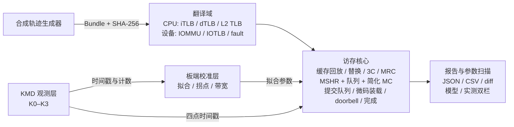

<div align="center">

# MemWhy

**SoC 访存路径建模、板端校准与性能归因**

用内存子系统的视角，把驱动层延迟拆到「请求 — 队列 — 翻译 — 完成」的每一段。

[](https://github.com/Caden-1224/memwhy/actions/workflows/ci.yml)
[](#构建)
[](#构建)
[](#license)

</div>

---

## 项目简介

MemWhy 是一个面向 SoC 驱动层性能问题的访存路径建模工具。它不满足于给出一笔操作的端到端延迟，而是沿具体请求回答：

1. **同一缺失序列下，吞吐为什么不同？** 卡在在途表项（outstanding entries）、回填（refill），还是下游队列？
2. **翻译方式怎样改变同一访问的延迟？** 页映射、IOMMU 开关分别影响哪一段？
3. **驱动提交一笔命令，延迟花在哪里？** 提交、doorbell、翻译，还是完成回写？

项目以合成轨迹为主输入，把请求沿「请求—队列—翻译—完成」路径建模；模型外推与板端实测在报告中双栏分列，永不混写。解析解锚点、守恒校验与固定种子 Bundle 回放共同保证结论可复现、可验证。

> 当前已完成构建系统、CLI 入口、轨迹 v1 格式与 Bundle 打包/校验；模型与板端观测能力将逐步落地。

## 核心概念

| 术语 | 含义 |
|---|---|
| **Bundle** | 绑定轨迹、配置、预热/测量窗口与成员哈希的最小复现单元；板端 Bundle 另含环境快照。 |
| **模型外推 / 板端实测（model / measured）** | 结论的两种来源口径；报告双栏分列，不混写。 |
| **校准点（calibration point）** | 用于拟合模型参数的少量板端实测数据，不是全量真值轨迹。 |
| **翻译域（translation domain）** | 一个翻译设备管理的地址空间与翻译上下文；设备侧按 per-core 域理解，不做全局广播假设。 |
| **doorbell** | 通知设备开始处理已提交命令的 MMIO 寄存器写；是 posted write。硬件与驱动语境的标准术语（doorbell register / doorbell write）。 |
| **四点时间戳（four-point timestamps）** | K1 在 DMA 提交路径采集的提交、issue_pending、完成回调、用户态读回四个时间点。 |
| **三段分解（three-segment breakdown）** | 把一笔设备命令的延迟拆为提交→doorbell→完成；用户态读回段单列，不计入设备三段。 |

## 核心特性

- **一套请求生命周期贯穿五项能力**：缓存、翻译、并行排队、设备路径与报告共用同一「请求—队列—翻译—完成」对象，避免各能力各建一套统计口径。
- **模型外推 / 板端实测双栏**：报告固定分为 `model` 与 `measured` 两栏；每个指标标注层级、分母、是否包含排队等口径，结论来源一目了然。
- **Bundle 级可复现**：轨迹、配置、预热/测量窗口与成员 SHA-256 绑定为 Bundle；同种子两次回放逐字节一致，损坏输入在回放前检出。
- **解析解 + 守恒校验**：顺序、固定步长、随机访问的闭式期望缺失数进入回归；总请求、写回字节与 3C 之和必须对账。
- **只观测不改驱动**：板端 KMD 只提供观测设施与最小 dmaengine client，不修改 rocket 调度、电源管理或 IOMMU 驱动本体。
- **板端校准而非全量采集**：承认 PMU 事件集与描述符环可观测性限制，用少量校准点约束模型，不夸大结论边界。

## 架构总览



## 能力范围

| # | 能力 | 关键内容 | 主要输出 |
|---|---|---|---|
| 1 | **缓存归因** | L1I/L1D/L2、LRU/RRIP、写回/写通、写分配、有限写回缓冲 | 命中/缺失/写回计数、3C 分解、MRC、MPKI、AMAT |
| 2 | **地址翻译** | CPU 侧多级 TLB 与共享翻译队列；设备侧 per-core IOMMU 翻译域 | TLB 缺失与遍历等待、IOMMU 延迟占比、invalidation stall |
| 3 | **并行排队** | 有限 MSHR、同行合并、可调发射窗口、简化内存控制器 | 在途数分布、表满/回填受阻/队列等待、双版本 AMAT |
| 4 | **设备路径** | pl330 提交队列→微码装载→doorbell→完成；tasklet 与 threaded IRQ | 提交/doorbell/完成三段分解、分段误差 |
| 5 | **轨迹与复现** | 轨迹 v1、Bundle 打包校验、参数扫描（sweep）、双报告 diff、环境快照 | 可复现实验包、CSV 参数扫描表、双栏报告 |

### 缓存归因

覆盖 L1I、L1D、L2 到主存的层次结构；请求分为取指、读、写、填充与写回，跨行访问按宽度拆分。默认 LRU，同时支持 RRIP；支持直接映射、组相联与全相联。3C 分解与 Mattson 栈距离 MRC 固定在 LRU 基线，RRIP 通过逐容量回放获得自己的 MRC。

### 地址翻译

CPU 侧建模 iTLB、dTLB、统一 L2 TLB、页表遍历延迟与共享翻译队列；设备侧按 rockchip-iommu 的 per-core 翻译域建模 IOVA→PA、IOTLB、context 隔离、invalidation 与 fault 上报，不做全局广播假设。

### 并行排队

有限 MSHR 表项、每项等待者、同行在途（outstanding）缺失合并与可调发射窗口；简化内存控制器只保留通道带宽、请求队列与固定服务时间，服务率由 CPU 侧 STREAM 类实测约束，不使用 DMA 带宽反推。

### 设备路径

pl330 按「提交队列→微码装载（microcode load）→doorbell→完成」建模；doorbell 是 posted write，提交→doorbell 段度量软件成本。完成上下文区分 pl330 tasklet 与 rocket threaded IRQ；rocket 的 pm_runtime resume/autosuspend 与 per-job IOMMU attach/detach 延迟单列成段。

### 轨迹与复现

轨迹 v1 记录核心、访问类型、地址与宽度；Bundle 绑定轨迹、配置、预热/测量窗口和成员哈希，采用临时目录→校验→原子重命名。板端 Bundle 额外保存内核版本、板卡型号、governor/OPP、thermal 状态、DDR 频率状态与中断亲和。

## 技术栈

| 层 | 技术 |
|---|---|
| 模型与 CLI | C++17、CMake、CTest |
| 内核观测 | Linux platform driver、DT overlay、dmaengine、debugfs、tracepoint、kprobe |
| 板端采集 | `perf_event_open`、`trace-cmd`、PMU |
| 工具与脚本 | Python、Shell |
| CI | GitHub Actions |

## 目标平台

| 角色 | 硬件 | 关键配置 |
|---|---|---|
| 主战板 | 立创泰山派 3M（RK3576） | 4×Cortex-A72 + 4×Cortex-A53，Mali-G52 MC3，6 TOPS NPU，4 GB LPDDR5 + 64 GB eMMC |
| 对照板 | RDK X5（旭日 5） | 8×Cortex-A55@1.5 GHz，10 TOPS BPU，4/8 GB LPDDR4，仅做 CPU 侧访存与带宽对照 |

内核基线以主线优先，BSP 6.1 仅作 K1 退路；测量时必须锁定 governor/OPP 并记录 thermal、DDR 状态与中断亲和。

## 快速开始

### 环境要求

- Linux（开发与板端实验在 Ubuntu 22.04 / WSL2 下进行）
- CMake 3.20+
- 支持 C++17 的编译器（GCC 11+ 或 Clang 14+）

### 构建与测试

```sh
git clone https://github.com/Caden-1224/memwhy.git
cd memwhy

cmake -B build -DCMAKE_BUILD_TYPE=Release
cmake --build build -j
ctest --test-dir build --output-on-failure
```

### 运行

```sh
./build/memwhy --version
# memwhy 0.1.0
```

## CLI 设计

目标接口（后续里程碑逐步实现）：

```sh
memwhy gen     --kind chain|matrix|stride --seed N --out trace.bin [kind 参数]
memwhy bundle  pack --trace trace.bin --config config.json --out bundle_dir/
memwhy replay  --bundle bundle_dir/ --report report.json
memwhy sweep   --bundle bundle_dir/ --param key=v1,v2,v3 --out sweep.csv
memwhy diff    report1.json report2.json
```

| 子命令 | 作用 | 状态 |
|---|---|---|
| `gen` | 生成指针链、矩阵遍历或 stride 扫描轨迹 | 规划中 |
| `bundle pack` | 打包轨迹、配置与 manifest，计算 SHA-256，原子重命名 | 已实现 |
| `bundle verify` | 校验 Bundle 成员哈希与 manifest | 已实现 |
| `replay` | 回放 Bundle 并生成双栏 JSON 报告 | 规划中 |
| `sweep` | 参数扫描输出 CSV，定位行为拐点 | 规划中 |
| `diff` | 对比两份报告的配置差异 | 规划中 |

## 报告格式

所有结论固定分为模型外推与板端实测两栏：

```json
{
  "meta": {
    "bundle_sha256": "...",
    "config": {},
    "seed": 0
  },
  "model": {
    "cache": {},
    "translation": {},
    "queueing": {},
    "device_path": {}
  },
  "measured": null
}
```

- `model` 与 `measured` 永不混写；没有板端数据时 `measured` 为 `null`。
- 每个指标附口径字段：层级、分母、是否包含排队。
- 参数扫描同时输出 CSV，便于直接定位拐点。

## 板端观测层

板端不重写驱动，只在内核态建立可观测提交路径：

| 级别 | 内容 | 产出 |
|---|---|---|
| **K0** | out-of-tree 模块 + misc/debugfs 节点 | `dmesg` 输出、debugfs 节点、干净 insmod/rmmod |
| **K1** | dmaengine client + DT overlay + 四点时间戳 | 提交/doorbell/完成三段 P50/P95；poll vs IRQ；coherent vs streaming |
| **K2** | rocket kprobe/ftrace + NPU IOMMU 对照（条件级） | 提交/完成事件；IOMMU identity vs DMA domain 带宽差 |
| **K3** | 板级 NPU enable、IOMMU 恢复 fix、tracepoint patch | 可查的 lore 链接与真板验证 |

测量纪律：锁 governor/OPP 或记录实际频率，记录 thermal 与 DDR 状态，绑定提交线程与中断亲和；同配置两次 P50 偏差目标小于 5%。

## 项目结构

```text
.
├── CMakeLists.txt
├── src/                  # CLI、模型与报告实现
├── tests/                # CTest 测试程序（轨迹格式等）
├── kernel/               # KMD 观测设施（Kbuild 占位，K0 起实现）
│   └── LICENSE           # GPL-2.0-only
├── .github/workflows/    # CI
├── README.md
└── LICENSE               # MIT（用户态）
```

## 设计原则

1. **合成轨迹为主，板端只做校准点。** 板端可观测性有限，不宣称采集全量访存轨迹。
2. **不引用未读过的源码。** 硬件事实与内核行为以实际阅读的代码和手册为依据。
3. **模型与实测分栏。** 两种来源的结论不混写，误差单独报告。
4. **可复现优先于好看。** 固定种子、Bundle 哈希、逐字节回放是报告成立的前提。
5. **观测设施不改主体。** KMD 不修改 rocket 调度、电源管理或 IOMMU 驱动本体。

## 已知局限

- 描述符环 cache 行为与 doorbell cache line 竞争不可直接实测，仅在 NPU 侧作模型外推。
- bank 映射、调度策略与写排空阈值作为参数扫描假设，结论偏趋势性。
- PMU 事件集受限，不可采的指标不报告。
- 简化 MC 的队列与带宽为拟合值，只保证趋势一致。
- 时间戳报告 P50/P95 与离散度，不宣称 ns 级绝对精度。

## Contributing

这是个人研究项目，欢迎通过 Issue 讨论问题、指出文档或模型中的错误。提交改动前请先开 Issue 对齐范围，避免大改动没有上下文。

## License

- 用户态代码（根目录除 `kernel/` 外）采用 [MIT License](LICENSE)。
- `kernel/` 下的内核模块代码采用 [GPL-2.0-only](kernel/LICENSE)，以符合 Linux 内核模块的许可要求。

---

<div align="center">

如果 MemWhy 对你的研究或工程有帮助，欢迎点一个 ⭐。

</div>
